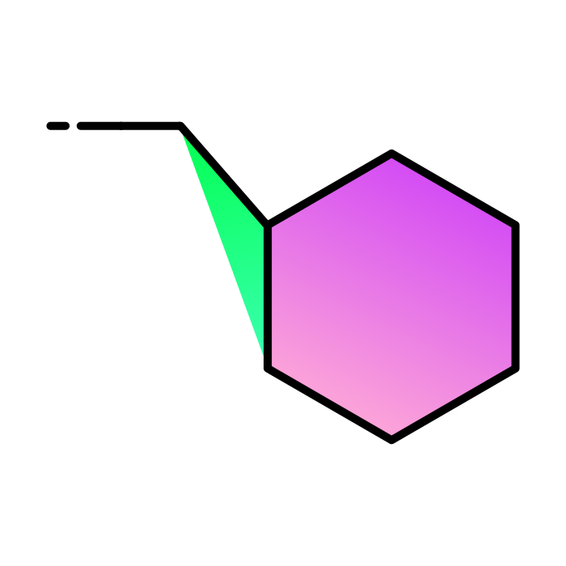
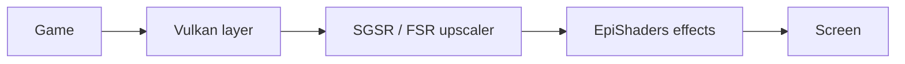

> ⚠️ **This is coded using AI, this is AI slop.**
> Every line in this repository was written by an AI assistant under the direction of one person. Expect rough edges, wrong guesses and things that only work on one phone.

 

# Epinephro

**Run Android games on custom Vulkan drivers, with upscalers, shaders and frame generation, no root needed.**

Adreno GPUs · Vulkan · arm64 · Android

 

---

## ✨ What it does

Epinephro is an Android app that loads other Android games inside its own process and runs them on a **custom Vulkan driver** (such as Mesa's Turnip, or a newer Adreno driver package) instead of the one that came with your phone. It needs no root. It uses [libadrenotools](https://github.com/bylaws/libadrenotools) to swap the driver in.

Because the app sits between the game and the GPU, it can also do things the game never asked for:

| | Feature |
|---|---|
| 🧩 | **Custom drivers**: load a newer or different Vulkan driver per game |
| 🔍 | **Upscalers**: render the game at a lower resolution and scale it up with **SGSR 1** or **FSR 1** |
| 🎨 | **EpiShaders**: ReShade-style effects (sharpening, anti-aliasing, colour, bloom, CRT and more) on top of any game |
| ⏩ | **Frame generation**: an in-between frame for every real frame (needs your own copy of `Lossless.dll`) |
| 🔺 | **OpenGL ES via ANGLE** (experimental): run OpenGL ES games by translating them to Vulkan, through our layer and your custom driver |
| 🎮 | **Virtual Xbox 360 controller**: on-screen sticks and buttons with a layout editor |
| 🛠️ | **Compatibility tools**: GPU and device spoofing, file redirects, asset-pack handling, per-game settings, logs |

**Status:** experimental. It has been tried on one phone (Adreno 619, Android 13) and mostly with one game. Other phones and games may not work. You need your own legitimate copies of any game; none are included. The game should be installed on your phone,just importing it in the app without having it on your phone MIGHT make it crash.

---

## ⚙️ How each feature works

### Loading a game

Imported games are not installed as separate apps. The importer unpacks the game's APK (or split APKs, or an XAPK with data) into the app's own storage. At launch, a second process of the app (`:guest`) loads the game's native libraries and Java code through its own class loader and impersonates the game's package, so the game believes it runs normally.

- **Asset packs and data:** requests for the game's Play Asset Delivery packs are answered from the local files; `Android/data` and `Android/obb` paths are redirected to folders inside the app.
- **Vulkan redirect:** every `libvulkan.so` reference in the game's libraries is renamed to `libvkshim.so`, our own layer. From then on every Vulkan call the game makes passes through it.
- **Import report:** after importing, you get a short report of the game's libraries and whether they use Vulkan or only OpenGL ES.

### Custom Vulkan drivers

`libvkshim.so` forwards the game's Vulkan calls to the real loader, and libadrenotools makes that loader open the driver you picked instead of the system one. Drivers can be imported and chosen per game. If something goes wrong, there is a switch back to the bundled driver.

### OpenGL ES via ANGLE (experimental)

Games that use OpenGL ES never touch Vulkan, so none of the above would apply. With the per-game **OpenGL ES via ANGLE** switch on, the game's GL/EGL libraries are renamed to a bundled copy of [ANGLE](https://chromium.googlesource.com/angle/angle), which translates OpenGL ES to Vulkan and is itself pointed at our Vulkan layer. The game then runs on the custom driver, and upscalers and shaders can work on it. The first start after switching rewrites the game's libraries from its stored APKs. Prebuilt ANGLE binaries come from [abnormalmaps/build-angle](https://github.com/abnormalmaps/build-angle).

### Resolution and upscalers

The game is told its screen is smaller than it really is (the **Resolution** setting). It renders into private images at that size. When the game presents a frame, the layer creates a real swapchain at the screen's full size and runs a small shader pass that scales the game's image up into it.

- **SGSR 1** (Snapdragon Game Super Resolution): a single-pass upscaler. Flat areas are scaled cheaply; where it detects an edge it does a more careful directional filter. It is the lighter of the two.
- **FSR 1** (AMD FidelityFX): two passes. **EASU** scales the picture with an edge-adaptive filter into a full-size image, then **RCAS** sharpens it. RCAS strength is a slider; at 0 % the RCAS pass is skipped entirely, which saves a full-screen pass.
- **Stretch to fit / keep ratio:** keep ratio draws the picture with black bars; stretch fills the screen.
- **Steady resolution:** some games lower their resolution on their own when busy. This setting stops that.

### Frame generation

The generator is the algorithm of Lossless Scaling's frame generation (LSFG), ported to run here through the work of [lsfg-vk](https://github.com/PancakeTAS/lsfg-vk). The shaders it needs are read from a `Lossless.dll` you provide (this app does not include it). Each game frame is copied, the generator creates an in-between frame, and both go through the same upscaling chain and are presented one after the other. A **Check Lossless.dll** button tests that the shaders compile on your phone. Quality and the optical-flow scale are adjustable.

### Virtual Xbox 360 controller

- **Overlay:** a transparent window of its own, drawn above the game. While it is on, touches go to the controller instead of the game.
- **Looks like a real pad:** the app registers a made-up Xbox 360 input device with Android and sends button, stick, trigger and D-pad events with the matching codes.
- **Native-input games:** games that read input straight from the system input queue in native code never see Java events. For those, the app hooks the game's input functions and hands out its own events, waking the game's input loop as a real event would.
- **Editor:** move, resize and hide every control; grid snapping; the editor bar can be dragged. Opacity and a vibration-on-press option are in the settings.

### GPU, CPU and device spoofing

Games sometimes check what hardware they run on. The app can report a different GPU name and ID, SoC and device model (for example, a flagship phone) to the game. The real GPU is still used for rendering.

### Everything else

- **Per-game settings:** every setting can be set for one game only.
- **File manager:** browse the app's game folders and the game data.
- **Focus guard:** keeps a game running when the notification shade opens.
- **Light mode:** turns off diagnostics (file and asset logging, driver call watching) for the best performance.
- **Guest log:** a one-tap log of the game's run, which makes debugging possible.

---

## 🎨 How EpiShaders works

EpiShaders runs **ReShade FX** effects on top of the game's picture. It does not use ReShade itself. It has its own small engine, written for this app.

1. **Compiling:** the effects ship as `.fx` source files. On the phone, the ReShade FX compiler (the open-source `reshadefx` library) turns each effect into SPIR-V, the format Vulkan shaders use. Nothing is precompiled.
2. **The effect list:** the app asks the compiler for each effect's settings (its `uniform` values: sliders, toggles, colour pickers). The settings page shows them under the effect's toggle when it is on, with the effect's own default values.
3. **The preset:** your choices are written to a small preset file when the game starts, and passed to the engine along with the list of enabled effects, in a fixed order: sharpening and anti-aliasing first, then colour, then bloom and vignette, with CRT effects last.
4. **Running:** after the upscaler has produced the final-size picture, each effect runs as one or more full-screen passes. The picture is passed between two or three working images (ping-pong) so that an effect can read what the last one wrote. The last pass writes into the screen's image.
5. **Direct mode:** when the game's picture is already the size of the screen (no upscaling, no black bars), the first effect reads the game's own image and the last one writes the screen image, which saves a whole full-screen copy.
6. **Dynamic values:** values such as time and the frame counter go into a small buffer that is updated every frame.
7. **Colour handling:** effects read and write the picture as it is (gamma encoded), without converting to and from linear colour on the way. Textures loaded from files, such as LUT images, are still read as authors expect.
8. **Timing:** every 600 frames the log lists the GPU time each effect used, so you can see what is expensive.

**Included effects:** LumaSharpen, AMD CAS, FXAA, SMAA, Fake HDR, Vibrance, Tonemap, Levels, Curves, Lift/Gamma/Gain, Colour Matrix, Technicolor, DPX, Sepia, Monochrome, LUT, Bloom, MagicBloom, Vignette, Cartoon, and the RetroArch CRT shaders (zfast, Easymode, Lottes, Lottes 2, Geom, cgwg, Aperture, Caligari, Hyllian, Pi).

---

## 🙏 Credits

This project stands on other people's work. Each file keeps its own licence header.

**Driver loading**
- [ANGLE](https://chromium.googlesource.com/angle/angle) by The ANGLE Project authors / Google (BSD-3-Clause), prebuilt by [abnormalmaps](https://github.com/abnormalmaps/build-angle)
- [libadrenotools](https://github.com/bylaws/libadrenotools) by bylaws (loads custom Vulkan drivers without root)
- [Mesa / Turnip](https://docs.mesa3d.org/drivers/freedreno.html) and the freedreno developers (the open-source Adreno Vulkan driver)

**Upscalers**
- [Snapdragon Game Super Resolution](https://github.com/SnapdragonGameStudios/snapdragon-gsr) by Qualcomm Innovation Center (BSD-3-Clause)
- [FidelityFX FSR 1](https://github.com/GPUOpen-Effects/FidelityFX-FSR) by AMD (MIT)
- FXAA 3.11 by Timothy Lottes (NVIDIA), through [Rendu](https://github.com/kosua20/Rendu) by Simon Rodriguez (MIT)

**Frame generation**
- **Lossless Scaling** by THS, whose frame-generation algorithm this builds on
- [lsfg-vk](https://github.com/PancakeTAS/lsfg-vk) by PancakeTAS and contributors (MIT), plus its bundled libraries (volk, pe-parse, dxbc)

**EpiShaders**
- [ReShade](https://reshade.me) and the `reshadefx` compiler by Patrick "crosire" Mours (BSD-3-Clause)
- The ReShade / SweetFX effect collections and their authors: Christian Cann Schuldt Jensen aka CeeJay.dk (LumaSharpen, Vibrance, Tonemap and more), Gilcher Pascal aka Marty McFly (Bloom), luluco250 (MagicBloom), and everyone credited in each `.fx` header
- AMD FidelityFX CAS (MIT), with its ReShade port by SLSNe and later improvements by Marty McFly, Lord of Lunacy, OopyDoopy and CeeJay.dk
- SMAA by Jorge Jimenez, Jose I. Echevarria, Belen Masia, Fernando Navarro and Diego Gutierrez
- The [RetroArch](https://www.retroarch.com) CRT shaders, as ported to ReShade FX in the RSRetroArch collection: Timothy Lottes (Lottes, Lottes 2), cgwg, Themaister and DOLLS (Geom, cgwg), EasyMode (Easymode, Aperture), caligari with a port by Hyllian (Caligari), Hyllian (Hyllian), davej (CRT-Pi), Greg Hogan aka SoltanGris42 (zfast_crt)
- [stb_image](https://github.com/nothings/stb) by Sean Barrett (public domain), [SPIRV-Headers](https://github.com/KhronosGroup/SPIRV-Headers) and the Vulkan headers by The Khronos Group, [glslang](https://github.com/KhronosGroup/glslang) for compiling the built-in shaders

**Inspiration**
- [Winlator](https://github.com/brunodev85/winlator), for the idea of an on-screen controller with a layout editor

**People and tools**
- Directed and tested by **Freecranegami**
- Written with **Claude** by Anthropic

---

## ⚖️ Licences

Epinephro's own code is free software under the **[GNU General Public License v3.0](LICENSE)**. You can use, study, change and share it, and if you distribute a modified version you must do so under the same licence and make its source available.

Third-party code keeps its own licence, and each file keeps its header. Everything bundled is compatible with the GPL-3.0:

| Licence | What |
|---|---|
| BSD-3-Clause | ANGLE (not bundled in the source, fetched at build time), Snapdragon Game Super Resolution, ReShade and the `reshadefx` compiler |
| MIT | FidelityFX FSR 1 and CAS, lsfg-vk and its framegen code, volk, pe-parse, Rendu (FXAA), several SweetFX / ReShade effects |
| zlib | the dxbc code that lsfg-vk bundles (from DXVK) |
| Public domain | stb_image |
| Khronos licences | SPIRV-Headers and the Vulkan headers |
| GPL-2.0-or-later (or "GPL", no version given) | the bundled CRT shaders Geom, cgwg, Caligari, CRT-Pi, zfast_crt, Easymode and Aperture. A "later version" or an unspecified version can be used under the GPL-3.0, which is why they can ship inside a GPL-3.0 app |

Custom Vulkan drivers (Qualcomm or Turnip packages) and the games themselves are **not** part of Epinephro and are not covered by this licence. Turnip is part of [Mesa](https://docs.mesa3d.org/license.html) (MIT); Qualcomm's driver is Qualcomm's proprietary software and comes from the driver package you choose, not from this repository.

## ⚖️ Disclaimer

Epinephro is not affiliated with Qualcomm, AMD, NVIDIA, Rockstar, Netflix, THS (Lossless Scaling) or any game publisher. Bring your own legitimately obtained games and your own `Lossless.dll`. It does not bypass any licence or Google Play checks. Use it at your own risk: it modifies how games talk to your GPU and may crash them or your phone's graphics stack.
